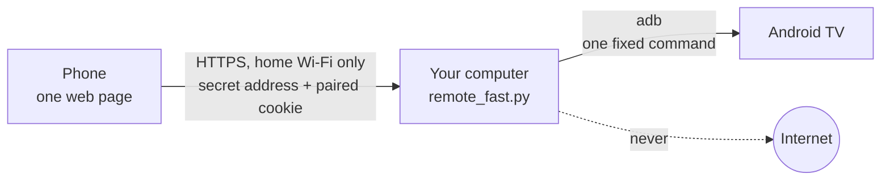
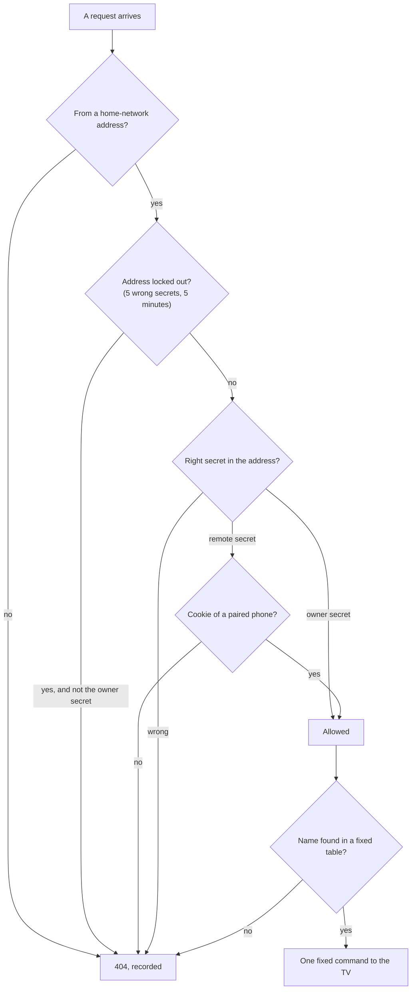

<div align="center">

# Local TV remote

**Your phone becomes the remote of your Android TV.**<br>
One small Python file. Nothing leaves your home network.

`no cloud` &nbsp;·&nbsp; `no account` &nbsp;·&nbsp; `no third-party package` &nbsp;·&nbsp; `each claim names its test`


</div>

<table>
<tr>
<td width="33%" valign="top"><b>Local by design</b><br>The phone talks to your computer, the computer talks to the TV. No service in between, nothing to sign up for, nothing recorded about what you watch.</td>
<td width="33%" valign="top"><b>Closed by default</b><br>No TV address, no certificate or no paired phone means no remote. Every request needs a secret and an encrypted connection.</td>
<td width="33%" valign="top"><b>Checked, not promised</b><br>Each claim on this page names the test behind it. Where there is no test, it says "not tested".</td>
</tr>
</table>

## How it works



The phone loads one page from `remote_fast.py`. Each button sends a small request back. The program looks the request up in a fixed list of commands and hands that one command to the TV through adb, Android's own debugging tool. Whatever the phone sends is only ever a name to look up: it never becomes part of a command.

## Four layouts, one page

Pick one with the **Layout** control in the settings below the remote. The choice is kept on the phone (localStorage); the server stores nothing about it.

| Layout | For | What you get |
| --- | --- | --- |
| **Touch** (default) | everyday use | A touchpad: swipe moves the focus, tap is OK. Hold the finger pushed in one direction and it keeps scrolling, faster the further you push. Swipes lock to one axis and a small step back does not trigger the opposite key. |
| **Future** | the neon look | The volume buttons become a bar with a live number, and the channel buttons become a number pad: type the channel number. |
| **90s** | button lovers | A classic button remote: number pad, a D-pad cross with OK instead of the touchpad, raised rubber-style keys. |
| **Simple** | anyone, at a glance | Only a large D-pad with OK, Back, Home, volume, mute and power. Everything else is hidden. Chosen from a short review of remote usability sources: few large keys and a physical-style D-pad are what people get on with best. |

Every layout also has, unless it hides them on purpose:

- **Keys**: Back, Home, Menu, Power, Play/Pause, Input, Volume (up, mute, down), Channel up and down.
- **App launchers**: Netflix, Prime, YouTube, Spotify, Twitch, the launcher. Opening an app closes the other apps in the list, to free the TV's small RAM. Nothing runs in the background by design.
- **Sound presets**: Voice, Movie, Night, Normal. They write the TV's own sound settings. The original values are kept in a restore file.
- **Owner view**: the same remote plus a live status panel (TV reachable, apps in memory with their size, free RAM, adb shell state, uptime, taps, send time, wrong-secret attempts, lockouts, traffic watch, live records of suspicious events). Counters live in memory only.

<details>
<summary><b>The Future volume bar in detail</b> (speed, safety limits, night)</summary>

<br>

- **Drag** up or down anywhere on it: 3 px per step, relative to where the finger landed, so a touch alone never jumps the volume.
- **Speed**: the number follows the finger at once and the TV walks to it. The tested TV ignores a direct "set volume" (`cmd media_session volume --set` and `--adj` do nothing) and only obeys the volume key, so the page asks for up to 5 key presses per request (the first leaves the moment the finger moves; the presses of one request run side by side), sends the next request only when those are done and always towards the newest number. Nothing queues up, a change of direction takes effect at once, and the TV moves at about 8 steps per second, the fastest it accepts them. When it has caught up the real level is read back.
- **Safety limits** (`VOL_LIMITS` at the top of `remote_fast.py`):

  | Limit | Default |
  | --- | --- |
  | Highest volume the bar can reach by day | 50 |
  | Highest volume at night (22:00 to 07:00) | 30 |
  | Most steps up in one drag | 10 |
  | Lowering | never limited |

  The number turns amber at the limit.
- **Night, anonymously**: night is decided by the phone's own clock inside the page. No time, place or time zone is asked of any service, nothing is sent and nothing is stored.

</details>

<details>
<summary><b>How the page fits your screen</b></summary>

<br>

- Every layout is scaled as one piece (between 0.7 and 1.6 times) to the screen as it is with the browser bars showing (address bar at the top or at the bottom, notch and home indicator), so a normal phone shows the whole remote without scrolling and a tablet shows it larger.
- It is sized when the page opens, when the layout changes and when the phone is turned, never while scrolling. Very small screens and phones held sideways stop at 0.7 and scroll.
- The first screen is the remote only. The settings (the Layout control and, for the owner, the status panel) start below it. Keys act the moment they are touched, so start a scroll on the small arrow strip under the remote, or tap that strip to jump to the settings.

</details>

## Get it running

**You need**: Python 3, Android platform-tools (`adb`, from developer.android.com/tools/releases/platform-tools) and OpenSSL (it ships with Git for Windows and with most Linux and macOS systems). Enable network debugging on the TV. Tested on Windows 11 only.

### 1. Download and verify

The release is one zip with its SHA-256. Before you open it, compare the hash of what you downloaded with the published one:

| System | Command |
| --- | --- |
| Windows PowerShell | `Get-FileHash .\tv-remote-<version>.zip -Algorithm SHA256` |
| Linux and macOS | `sha256sum tv-remote-<version>.zip` |

They must be identical. Inside the zip, `SHA256SUMS` lists the hash of every file and `setup.py` checks them again before it configures anything; it stops on the first mismatch. The build is reproducible: the same files always give the same zip and the same hash.

### 2. Guided setup (recommended)

Unzip, open a terminal in the folder, run:

```
python setup.py
```

It
1. verifies the files against `SHA256SUMS`;
2. finds adb or asks for its path;
3. asks for the TV address (home-network addresses only), writes `tv.txt` and tries `adb connect`;
4. creates the TLS certificate for this computer's LAN address (valid one year);
5. creates the two secrets (five random words each);
6. runs the self-check.

It never overwrites an existing file, can be run again safely and changes no system setting. It only prints the Windows commands for the firewall rule and for start at logon; you run them yourself.

### 3. Start and pair

```
python remote_fast.py
```

(or `pythonw` for no window). Open the **owner URL** printed in the console once on the phone to pair it, and bookmark it.

<details>
<summary><b>Setup by hand</b></summary>

<br>

Put the TV address in `tv.txt` (and the adb path in `adb.txt` if adb is not on PATH), create `cert.pem` and `key.pem` for the computer's LAN address with OpenSSL, then run `python remote_fast.py`. The secrets are created on first start and kept in `token.txt` and `admin.txt`.

</details>

<details>
<summary><b>Running on Windows</b> (autostart, firewall)</summary>

<br>

- Autostart: a scheduled task "TV Remote" runs `pythonw.exe remote_fast.py` at logon (restart on failure, no admin rights). Remove it with `Unregister-ScheduledTask -TaskName 'TV Remote' -Confirm:$false`.
- Firewall: with inbound blocked by default, one allow rule is needed: TCP, the remote port, local subnet, the Python program, Private profile (`New-NetFirewallRule`, run once in an administrator PowerShell). Remove it with `Remove-NetFirewallRule`.
- Start waits for the network, so a logon before Wi-Fi is up does not stop it.

</details>

<details>
<summary><b>Unpair a device</b></summary>

<br>

Delete `device.txt` and restart. Open the owner URL on the devices you want to keep.

</details>

## Security model



- **Closed by default.** It needs `tv.txt`, a certificate and a paired device before the plain URL answers. Without a certificate it refuses to start and never falls back to plain HTTP (TLS 1.2 minimum).
- **Home network only.** Binds to the laptop LAN address only, serves private-range clients only.
- **Two secrets** in the URL path, compared in constant time. Five wrong secrets lock that client address for five minutes. The owner secret always gets through.
- **Pairing.** The owner URL gives the device a random 256-bit cookie (`Secure`, `HttpOnly`, `SameSite=Strict`, 90 days). The server stores only its SHA-256 hash (newest ten devices) and compares in constant time. Encrypting the cookie would add nothing: it is opaque random data and already encrypted by TLS.
- **Fixed commands.** Commands to the TV come only from fixed tables (keys, apps, sound presets, 1 to 5 volume steps). User input is only a lookup key, never part of a command. POST only; no CSRF risk because the secret is in the URL and not in a cookie.
- **Strict response headers** (no-store, CSP with `default-src 'none'`, nosniff, no referrer, no framing, no camera/microphone/location). Requests and secrets are never logged. Nothing is recorded about what is watched.
- **Traffic watch.** Every 15 seconds the server checks its own and adb's connections. Anything to the internet or to a host other than the TV is recorded and turns the panel to ALERT. Inbound from non-LAN addresses is recorded too. Limits: Windows only (it reads `tasklist` and `netstat`), TCP only, sampled every 15 seconds, so a very short connection can be missed. On other systems the panel says "not available on this system" and does not start the watch.
- **Exclusive port bind.** A second server cannot share the port.

<details>
<summary><b>Known limits</b></summary>

<br>

- The volume bar shows the level read when the Future layout opens, when the page comes back to the front and after each drag, so a change made meanwhile with another remote shows only then.
- A long drag takes the TV a few seconds to follow (about 8 steps per second, the TV's own limit for key presses over adb).
- The volume safety limits apply to the Future bar only, not to the Vol+ key of the other layouts.
- The 90s D-pad sends one step per press (no hold to repeat).
- No cap on simultaneous LAN connections.
- Self-signed certificate (the browser warns, trust on first use).
- A paired phone that is unlocked can use the remote.
- The first key after the TV was off can be lost.
- The certificate is tied to the laptop's LAN address and has a one-year life.

</details>

## Checked claims

Every promise above, and the check behind it (`python test_remote_fast.py`). "Not tested" is stated plainly.

| Claim | Checked by | State |
| --- | --- | --- |
| Closed by default, the plain URL needs a paired device | closed-by-default and right-secret-without-cookie checks | tested |
| Pairing cookie: only its hash is stored, a forged cookie is refused | stored-hash and forged-cookie checks | tested |
| Cookie is `Secure`, `HttpOnly`, `SameSite=Strict`, 90 days | cookie flags check | tested |
| Commands only from fixed tables, volume steps included | allowlist, `snd/Evil`, volume step checks | tested |
| Status panel for the owner only | status panel check | tested |
| Private-range clients only | non-LAN client check | tested |
| Five wrong secrets lock the address, the owner still gets in | lockout checks | tested |
| Requests and secrets are never logged | log check | tested |
| No way to call out except adb to the TV (code) | import list, no dynamic code, only adb/tasklist/netstat started, only the TV address dialled, tripwire at run time | tested, see limits below |
| The page cannot load from or send to anywhere else; strict headers | page checks and exact CSP check | tested |
| TLS mandatory, never plain HTTP, TLS 1.2 minimum | none | not tested |
| Binds to the LAN address only, exclusive port | none | not tested |
| Secrets compared in constant time | none (read in the code: `hmac.compare_digest`) | not tested |
| Traffic watch reports outbound connections | none | not tested |

What the "stays local" checks show: this version of the file holds no way to call out except adb to the TV, and any change that adds one turns the test red until a person reviews it. What they do not show: a tripwire is not a defence against an author who hides code on purpose, and it says nothing about what adb (a Google program), Windows or the TV do on their own. `script-src 'unsafe-inline'` stays because the page is one self-contained file; the page is safe from injected script because nothing a visitor types is ever written into it.

### Run the checks yourself

```
python test_remote_fast.py
```

Covers closed-by-default, pairing, forged cookie, allowlisted keys only, number pad, volume steps (fixed table, at most 5, level read by a paired device only), owner-only status, non-LAN clients, lockout and owner bypass, ASCII-only page.

## Read the code

`remote_fast.py` is written to be read top to bottom, with a map at the top and a comment on every decision: settings, the complete list of commands, secrets and pairing, talking to the TV, the owner panel, the page (style, behaviour, buttons), the web server, start.

| File | Purpose |
| --- | --- |
| `remote_fast.py` | The whole server and page. Standard library only. |
| `test_remote_fast.py` | Assert checks, run on a temporary copy with its own secrets. |
| `setup.py` | Guided setup: checks the files, finds adb, asks for the TV, creates the certificate and secrets, runs the checks. |
| `make_package.py` | Builds the one-file download with its SHA-256 (for maintainers). |
| `LICENSE` | GNU Affero General Public License v3. |
| `SECURITY.md` | How to report a security problem. |
| `docs/layouts.jpg` | The picture at the top of this page. Not part of the download. |
| `SHA256SUMS` | Only in the download: the hash of every file inside, checked by `setup.py`. |

Files that exist only on your computer, next to the script:

| File | Purpose |
| --- | --- |
| `tv.txt` | TV address and adb port, for example `192.168.1.50:5555`. Required. |
| `adb.txt` | Path to `adb` (optional, defaults to `adb` on PATH). |
| `cert.pem`, `key.pem` | TLS certificate and key. Required: no certificate, no start. |
| `token.txt` | Secret for the plain remote URL. `setup.py` writes five random words; if the server has to create it itself (no setup) it uses a random URL-safe string instead. |
| `admin.txt` | Second secret for the owner URL, same rule as `token.txt`. |
| `device.txt` | SHA-256 hashes of paired cookies, one per line. Created on pairing. |

The secret files and the key are never committed or published. The code holds no personal data.

## License

GNU Affero General Public License v3.0 or later (see `LICENSE`). You may use and change the code, but if you distribute it, or let others use a modified version over a network, you must publish your version under the same license.
