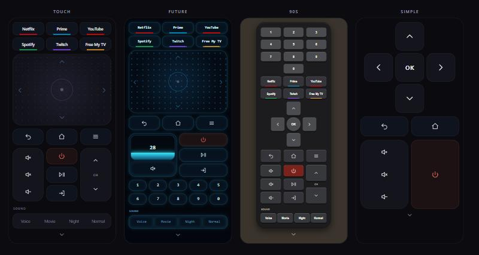
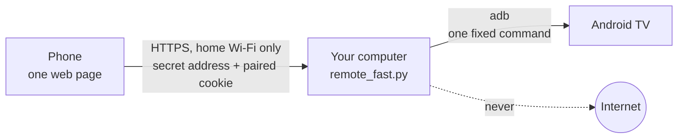
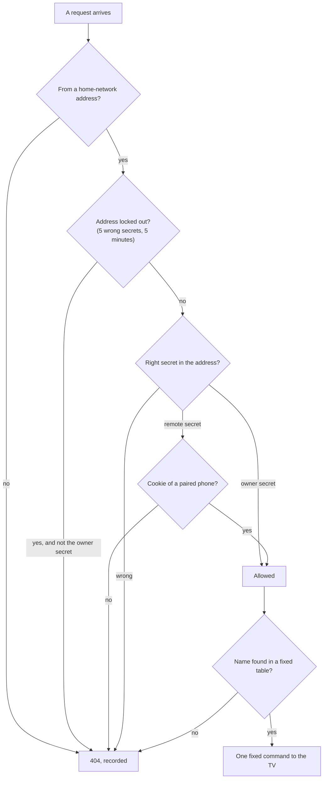

<div align="center">

# Local TV remote

**Your phone becomes the remote of your Android TV.**<br>
One small Python file. Nothing leaves your home network.

`no cloud` &nbsp;·&nbsp; `no account` &nbsp;·&nbsp; `no third-party package` &nbsp;·&nbsp; `each claim names its test`



</div>

<table>
<tr>
<td width="33%" valign="top"><b>Local by design</b><br>The phone talks to your computer, the computer talks to the TV. No service in between, nothing to sign up for, nothing recorded about what you watch.</td>
<td width="33%" valign="top"><b>Closed by default</b><br>No TV address, no certificate or no paired phone means no remote. Every request needs a secret and an encrypted connection.</td>
<td width="33%" valign="top"><b>Checked, not promised</b><br>Each claim on this page names the test behind it. Where there is no test, it says "not tested".</td>
</tr>
</table>

## Which TVs

| | |
| --- | --- |
| **Tested on** | Philips Android TV (Android 14). |
| **Expected to work, not yet tested** | Other TVs and boxes that run Android TV or Google TV and offer network debugging (adb): Sony, TCL, Xiaomi, Hisense models with Google TV, Chromecast with Google TV, Nvidia Shield and similar. |
| **Not supported** | Samsung (Tizen), LG (webOS), Roku and Hisense VIDAA. They have no adb, which is the only way this remote talks to a TV. Each would need its own, different way in; that is not built and not promised. |

The remote does not keep a list of brands. When the page opens it asks the TV what it is and what it has, shows it at the top of the settings ("Connected to: ...") and offers only what that TV can do: buttons for the apps that are installed, the sound presets only where their settings exist, the microphone and camera blocks only from Android 12 on. What a TV lacks is hidden or greyed out with the reason. If the TV does not answer, nothing is hidden.

Tried it on another TV? Please open an issue with the "Connected to" line and what worked and what did not: that is how a brand moves from "expected" to "tested".

## How it works



The phone loads one page from `remote_fast.py`. Each button sends a small request back. The program looks the request up in a fixed list of commands and hands that one command to the TV through adb, Android's own debugging tool. Whatever the phone sends is only ever a name to look up: it never becomes part of a command.

## Four layouts, one page

Pick one with the **Layout** control in the settings below the remote. The choice is kept on the phone (localStorage); the server stores nothing about it.

| Layout | For | What you get |
| --- | --- | --- |
| **Touch** (default) | everyday use | A touchpad: swipe moves the focus, tap is OK. Hold the finger pushed in one direction and it keeps scrolling, faster the further you push. Swipes lock to one axis and a small step back does not trigger the opposite key. |
| **Future** | the neon look | The volume buttons become a bar with a live number, and the channel buttons become a number pad: type the channel number. |
| **90s** | button lovers | A classic button remote: number pad, a D-pad cross with OK instead of the touchpad, raised rubber-style keys. |
| **Simple** | anyone, at a glance | Only a large D-pad with OK, Back, Home, volume, mute and power. Everything else is hidden. Chosen from a short review of remote usability sources: few large keys and a physical-style D-pad are what people get on with best. |

Every layout also has, unless it hides them on purpose:

- **Keys**: Back, Home, Menu, Power, Play/Pause, Input, Volume (up, mute, down), Channel up and down.
- **App launchers**: Netflix, Prime, YouTube, Spotify, Twitch, the launcher. Opening an app closes the other apps in the list, to free the TV's small RAM. Nothing runs in the background by design.
- **Sound presets**: Voice, Movie, Night, Normal. They write the TV's own sound settings. The original values are kept in a restore file.
- **Privacy panel** (in the settings, under Layout): what the TV itself reports about cameras and microphones, whether a camera and a microphone are found, two switches that block them for every app, and one button that revokes the microphone and camera permission from every app. Details below.
- **Security panel** (in the settings, under Privacy): a read-only check of the TV's settings, the network ports it listens on, a switch for the Cast receiver and a switch that asks apps to limit ad personalisation. Details below.
- **Optimize TV** (in the settings, under Security): free memory, free storage, time since the TV started and the age of its last security patch, with one button that cleans up and shows the numbers before and after. Details below.
- **Owner view**: the same remote plus a live status panel (TV reachable, apps in memory with their size, free RAM, adb shell state, uptime, taps, send time, wrong-secret attempts, lockouts, traffic watch, live records of suspicious events). Counters live in memory only.

<details>
<summary><b>The Future volume bar in detail</b> (speed, safety limits, night)</summary>

<br>

- **Drag** up or down anywhere on it: 3 px per step, relative to where the finger landed, so a touch alone never jumps the volume.
- **Speed**: the number follows the finger at once and the TV walks to it. The tested TV ignores a direct "set volume" (`cmd media_session volume --set` and `--adj` do nothing) and only obeys the volume key, so the page asks for up to 5 key presses per request (the first leaves the moment the finger moves; the presses of one request run side by side), sends the next request only when those are done and always towards the newest number. Nothing queues up, a change of direction takes effect at once, and the TV moves at about 8 steps per second, the fastest it accepts them. When it has caught up the real level is read back.
- **Safety limits** (`VOL_LIMITS` at the top of `remote_fast.py`):

  | Limit | Default |
  | --- | --- |
  | Highest volume the bar can reach by day | 50 |
  | Highest volume at night (22:00 to 07:00) | 30 |
  | Most steps up in one drag | 10 |
  | Lowering | never limited |

  The number turns amber at the limit.
- **Night, anonymously**: night is decided by the phone's own clock inside the page. No time, place or time zone is asked of any service, nothing is sent and nothing is stored.

</details>

<details>
<summary><b>The Privacy panel in detail</b> (what is a real block and what is not)</summary>

<br>

- **What it shows**, read from the TV each time the panel scrolls into view (it takes the TV about 2 seconds) and never stored: Camera found or not found, Microphone found or not found (built in, USB, Bluetooth, headset inputs), the apps that hold the microphone permission and the apps that hold the camera permission.
- **What the switches do**: they turn on Android's own system-wide blocks (`cmd sensor_privacy`, Android 12 and later). While a block is on, the system gives every app silence or a black picture, whatever permission the app holds. After a press the page asks the TV again and shows the state the TV reports, never an assumed one.
- **Greyed-out controls**: a switch with nothing to act on is greyed out and says why ("Camera: not found", "No permissions to revoke"), so the panel reads at a glance. A block that is already on stays clickable so it can always be turned off. This is done in the page; the server does not re-check the TV before a switch. Note for TVs that accept a USB webcam: the camera switch wakes up as soon as one is plugged in and the panel is opened again.
- **Revoke all permissions**: one fixed command that runs on the TV, walks the TV's own app list and takes the microphone and camera permission away from every app that holds it (`pm revoke`). Android closes an app when it loses a permission, so an app you are watching may restart. There is no "give back" button: an app asks again the next time it wants the permission, and you decide then.
- **Checked on the tested TV**: the TV accepts both blocks, stores them and reports them back, and turning them off restores the previous state. The tested TV reports no camera and one built-in microphone input. Revoke all was run on it: an app that held the microphone permission no longer held it afterwards, read back from the TV.
- **Not checked**: no recording was made to prove that an app really gets silence while the block is on; that part is Android's own enforcement. Whether the block survives a TV restart was not tested (the panel shows the real state when you open it). A microphone that does not go through Android (for example one handled only by the TV maker's firmware) is outside this switch.
- **Side effect**: with the microphone blocked, voice search does not hear you until you allow it again.
- **Three states, in all three panels** (Privacy, Security, Optimize): "Asking the TV...", the answer, or "The TV did not answer.". The last one also covers a request that never reached the remote's computer (phone off the Wi-Fi, computer asleep), so a panel never stays on "Asking the TV..." and a button never stays on "Revoking..." or "Optimizing...". Scroll the panel out of view and back to ask again.
- The panel changes nothing else: no app is disabled, enabled or uninstalled.

</details>

<details>
<summary><b>The Security panel in detail</b> (what it checks, what the switches really do)</summary>

<br>

- **The check**, read from the TV when the panel scrolls into view and never stored, one line each, marked `ok` or `CHECK`: accessibility services (they can read the screen), apps that read notifications, apps allowed to install apps, apps that see what you use, location, voice hotword. `CHECK` means "worth a look", not "wrong": a launcher that shows what is playing reads notifications on purpose.
- **Open doors on the home network**: the ports the TV listens on, with a name for the well-known ones (Cast, the Android TV remote service, network debugging, which is what this remote uses) and `unknown` for the rest, each followed by who holds it open: the app, the system program, or "the system". So an unknown port is never anonymous: you see which app to close or remove. Read-only.
- **Cast switch**: turns Google's Cast receiver off (`pm disable-user`) and on again (`pm enable`, then its service is started). Off means no device on the Wi-Fi can send video to the TV, and you cannot cast either. Nothing is uninstalled. Measured on the tested TV: off closes the three Cast ports at once; on brings them back within seconds.
- **Ad personalisation switch**: sets or removes Android's "limit ad tracking" request. It is a request to well-behaved apps, not a block, and whether an app honours it cannot be verified from here. The TV stores it and reports it back.
- **Not covered**: data collection by the TV maker and Google's "usage and diagnostics" are not readable over adb; check them in the TV's own privacy menu. The age of the security patch is in the Optimize panel.

</details>

<details>
<summary><b>Optimize TV in detail</b> (what it does, what it cannot do)</summary>

<br>

- **What it shows**, read from the TV when the panel scrolls into view and never stored: memory free, storage free, how long the TV has been on, the Android version and the date of the last security patch with its age in months.
- **Optimize now** runs one fixed command on the TV. First it closes the streaming apps of the remote's app list that are not on screen (the TV itself reports which app is on screen, and that one is skipped, so what you are watching is never closed). This catches an app the TV started by itself after a restart, or one left open when another was opened from the TV's own menu. Then two steps that are safe on any Android TV: `am kill-all` ends background processes that Android itself marks as safe to end (never the app on screen), and `pm trim-caches` asks every app to drop its cache files. Then the TV is read again and the change is written next to each number.
- **Measured on the tested TV**: the memory step freed almost nothing (this remote already closes the other apps when it opens one), the cache step freed 146 MB of storage. Caches are rebuilt as apps need them, which means new writes to the TV's storage, so this is not a button to press every day.
- **Clean restart**: after a confirmation it takes a picture of what matters (the privacy blocks, who holds the microphone and camera permission, the security settings, the open ports and who holds them), runs the same clean-up, restarts the TV, waits until it answers again, then takes the picture again and lists every change that leaves the TV more exposed than before. If the list is not empty it tells you to press Power. The picture lives in the page for those few minutes only; nothing is saved on the phone or on the server, so keep the page open until it reports.
- **Measured on the tested TV**: back and answering after 68 seconds, network debugging came back by itself, every block, permission and switch was as it had been left, and free memory went from 476 to 703 MB. If a TV does not bring network debugging back by itself, this remote cannot reach it until it is turned on again in the TV's menu: the page says so after 5 minutes.
- **Not automatic on purpose**: the remote never turns the TV off by itself after a restart. It shows what changed and leaves the decision to you, because a TV in standby cannot be turned on again over the network.
- **After a week without a restart** the panel suggests a clean restart.
- **What it cannot do, plainly**: nothing here changes what wears a TV out. Panel hours, brightness and heat are outside adb's reach on the tested TV (it reports no temperature), and no app is disabled, removed or re-enabled by this button.
- **Security patch age**: counted with the phone's own clock, nothing is looked up online. Android publishes security fixes every month, so each month of age is one round of fixes the TV does not have. Past six months the panel shows a warning and points to the section below. It is an age, not a vulnerability scan.
- **Known fixes the TV does not have**: the remote ships a list (`cve_data.json`) of the fixes rated Critical or High in the official Android Security Bulletins since January 2023, each with its CVE number, the part of Android, the kind of flaw and the Android versions it applies to. The server counts the ones published after the TV's patch month for the TV's Android version and the panel shows how many are critical, how many high, and the CVE numbers of the ones usable from a distance (RCE). Nothing is looked up online while the remote runs.
- **How honest that list is**: it is only as fresh as the release (the panel shows the day it was made); flaws found later are not in it. The bulletins are written for all Android devices, so not every entry can be reached on a TV. Fixes in chips, the kernel and other maker-specific parts are not counted, because they depend on the hardware. It is a list to judge the risk by, not a scan of the TV.
- **How the list is kept current**: before each release a maintainer runs `python make_cve_data.py`. It reads the official index of bulletins on source.android.com, downloads every bulletin page and takes the rows mechanically from the tables, nothing is typed by hand; it stops without writing if the site cannot be read or its layout has changed. It is the only file of the project that goes on the internet and it is not part of the running remote or of the download.
- **Still updated through the store**: three parts of Android keep getting fixes from the app store even after the TV maker has stopped: the WebView (the web engine inside apps), Google Play services and the "Google Play system update". The panel shows the WebView version and the dates of the other two with their age. They do not replace system patches, but while they are fresh a good share of the usual ways in stays patched. A date that is far behind means that layer has stopped too.

</details>

<details>
<summary><b>How the page fits your screen</b></summary>

<br>

- Every layout is scaled as one piece (between 0.7 and 1.6 times) to the screen as it is with the browser bars showing (address bar at the top or at the bottom, notch and home indicator), so a normal phone shows the whole remote without scrolling and a tablet shows it larger.
- It is sized when the page opens, when the layout changes and when the phone is turned, never while scrolling. Very small screens and phones held sideways stop at 0.7 and scroll.
- The first screen is the remote only. The settings (the Layout control and, for the owner, the status panel) start below it. Keys act the moment they are touched, so start a scroll on the small arrow strip under the remote, or tap that strip to jump to the settings.

</details>

## Get it running

**You need** a Windows computer that stays on while you use the remote, an Android TV or Google TV on the same Wi-Fi, and a phone on that same Wi-Fi (not a guest network). About 20 minutes. Everything is free. Tested on Windows 11 and on a Raspberry Pi 5 with Alpine Linux (see "Running on a Raspberry Pi" below). Take the steps in order. After each step there is **what you should see**; if you see something else, go to **If not**. Every step also works for most Android TV brands (Sony, Philips, TCL, Hisense, Xiaomi, Nvidia Shield and others); only the menu names differ a little.

### Step 1. Switch on debugging on the TV

**Do:** On the TV open Settings, then About (sometimes System, then About). Find **Build** (it can be called "Android TV OS build" or "Build number"). Press OK on it **7 times**. A message says you are now a developer. Go back one level, open **Developer options** and switch on **USB debugging** and, if you see a separate switch, **Network debugging** (also called "ADB debugging" or "Wireless debugging"). Then find the TV's address: Settings, Network, your Wi-Fi, **IP address**. It looks like `192.168.1.50`. Write it down.

**You should see:** the debugging switch is ON, and you have a number like `192.168.1.50`.

**If not:** no Developer options after 7 presses: press the Build line again (some TVs need 10 presses) or look under Settings, Device Preferences, About. No IP address: your TV may show it under Network, Advanced.

### Step 2. Install three free programs

**Do:**
1. **Python**: go to python.org/downloads, download and run the installer. On its first screen **tick "Add python.exe to PATH"**, then Install.
2. **Android platform-tools** (it contains `adb`): go to developer.android.com/tools/releases/platform-tools, download "SDK Platform-Tools for Windows", right click the zip, Extract All, and put the folder at `C:\platform-tools`.
3. **Git for Windows** (it brings OpenSSL, which makes the certificate): go to git-scm.com, download and run the installer, press Next until it ends.

Now open **PowerShell**: press the Windows key, type `PowerShell`, press Enter. Type these three lines, one at a time, pressing Enter after each:

```
python --version
& "C:\platform-tools\adb.exe" version
& "C:\Program Files\Git\usr\bin\openssl.exe" version
```

**You should see:** a version on each line (`Python 3.x`, `Android Debug Bridge version ...`, `OpenSSL ...`).

**If not:** "python is not recognised": run the Python installer again, choose Modify or Repair, and make sure "Add python.exe to PATH" is ticked; then close and reopen PowerShell. An error on adb: check the folder is exactly `C:\platform-tools` and that `adb.exe` is inside it.

### Step 3. Download the remote and check it is the real one

**Do:** open github.com/sga95/tv-remote/releases/latest and download `tv-remote-<version>.zip`. On the same page copy the **SHA-256** line. Then in PowerShell (replace the file name with the one you downloaded):

```
Get-FileHash $HOME\Downloads\tv-remote-<version>.zip -Algorithm SHA256
```

**You should see:** a long line of letters and numbers that is **identical** to the SHA-256 on the page (capitals or small letters do not matter).

**If not:** if even one character differs, delete the file and download it again. Do not open it. If it still differs, stop and report it (SECURITY.md).

### Step 4. Unzip it and open a PowerShell window inside the folder

**Do:** right click the zip, **Extract All**, choose `Documents\tv-remote`. Open that folder in File Explorer, click on the **address bar** at the top, type `powershell` and press Enter. A blue window opens, already inside the folder.

**You should see:** a PowerShell window whose last line ends with `tv-remote-<version>>` or the folder's name.

**If not:** type `cd $HOME\Documents\tv-remote` and press Enter (use the folder name inside it if there is one more level).

### Step 5. Run the guided setup

**Do:** type this and press Enter:

```
python setup.py
```

Answer the questions: if it asks for the path to adb, type `C:\platform-tools\adb.exe`. When it asks for the TV address, type the number from step 1. **Now look at the TV screen**: a box asks "Allow debugging?". Tick **Always allow from this computer** and choose **OK**. Back in the window, press Enter if it says to.

**You should see:** the lines `1.` to `6.`, a line saying the TV answers, `all checks passed`, and then `Done. Next:`.

**If not:** the setup says what is wrong in plain words and lets you try again. Fix it and press Enter, or type `s` and Enter to skip. You can run `python setup.py --check` at any moment to see everything that is wrong and what to do (it never changes anything). A STOP line about a file not matching means the download is damaged: go back to step 3.

### Step 6. Start the remote

**Do:** type this, and **leave the window open** (closing it stops the remote):

```
python remote_fast.py
```

If Windows asks to allow Python through the firewall, tick **Private networks** and choose **Allow access**.

**You should see:** two lines starting with `https://`: the **plain link** and the **owner link**. The owner link is also saved in the file `admin.txt` (open it with Notepad).

**If not:** an error mentioning the certificate or `tv.txt`: run `python setup.py` again. "Address already in use": another copy is running, see the table below.

### Step 7. Open it on the phone and pair it

**Do:** on the phone (same Wi-Fi) open the browser and type the **owner link** exactly. The browser says the connection is **not private** or **not secure**. This is expected: your own computer made the certificate. Tap **Advanced** (Safari on iPhone: **Show Details**), then **continue** or **visit this website**. Bookmark the page.

**You should see:** the remote with its buttons. Opening the owner link once **paired the phone**: from now on the plain link also works on this phone.

**If not:** the page does not open or a white or black page: see the table below.

### Step 8. Try it

**Do:** tap **Volume +** on the phone.

**You should see:** the volume goes up on the TV.

**If not:** run `python setup.py --check` and do what it says first.

### Step 9 (optional). Start it by itself when you sign in to Windows

See "Running on Windows" below. Until then, run step 6 each time you want to use the remote.

<details>
<summary><b>Setup by hand</b></summary>

<br>

Put the TV address in `tv.txt` (and the adb path in `adb.txt` if adb is not on PATH), create `cert.pem` and `key.pem` for the computer's LAN address with OpenSSL, then run `python remote_fast.py`. The secrets are created on first start and kept in `token.txt` and `admin.txt`.

</details>

<details>
<summary><b>Running on Windows</b> (autostart, firewall)</summary>

<br>

- Autostart: a scheduled task "TV Remote" runs `pythonw.exe remote_fast.py` at logon (restart on failure, no admin rights). Remove it with `Unregister-ScheduledTask -TaskName 'TV Remote' -Confirm:$false`.
- Firewall: with inbound blocked by default, one allow rule is needed: TCP, the remote port, local subnet, the Python program, Private profile (`New-NetFirewallRule`, run once in an administrator PowerShell). Remove it with `Remove-NetFirewallRule`.
- Start waits for the network, so a logon before Wi-Fi is up does not stop it.

</details>

<details>
<summary><b>Running on a Raspberry Pi</b> (always on, no laptop needed)</summary>

<br>

The same files run on a small always-on computer, so the remote works with the laptop switched off. The code does not change. Tested on a Raspberry Pi 5 with Alpine Linux 3.24 (aarch64), set up without a monitor, SSH by key only, in diskless mode (the system runs from memory, the SD card is written only when you save on purpose).

1. Install the tools: `apk add python3 android-tools openssl`.
2. Copy the unzipped package to the home folder of a normal user (never run it as root) and run `python3 setup.py` there. The certificate and the two secrets are created on the Pi, so you get **new links** and the phone must be paired once again with the owner URL.
3. The Pi makes its own adb key. The first time it connects, the TV asks to allow debugging from this computer: accept it (tick "always allow").
4. Run it as a service so it starts at boot and restarts if it stops. This is the OpenRC file used on the Pi, saved as `/etc/init.d/tv-remote` (replace `<user>`), made executable, then `rc-update add tv-remote default`:

   ```
   #!/sbin/openrc-run
   name="tv-remote"
   description="Local TV remote (HTTPS, port 8765)"
   supervisor="supervise-daemon"
   command="/usr/bin/python3"
   command_args="remote_fast.py"
   command_user="<user>:<user>"
   directory="/home/<user>/tv-remote"
   output_log="/dev/null"
   error_log="/var/log/tv-remote.err"
   respawn_delay=5
   respawn_max=0
   export HOME=/home/<user>

   depend() {
       need net
       after firewall nftables
   }

   start_pre() {
       checkpath --file --owner <user>:<user> --mode 0600 /var/log/tv-remote.err
   }
   ```

   Normal output goes to nowhere on purpose: the server prints the secret page addresses when it starts and they must never reach a log. Only error messages are kept, in a file only the service user can read (it lives in memory on a diskless system). `HOME` is set so adb finds the user's own key in `~/.android`. In `adb.txt` put `/usr/bin/adb`.
5. Firewall: refuse everything coming in, then allow only SSH and the remote's port (8765) from your home network. Nothing on the Pi should be reachable from the internet, so do not forward a port to it on the router.
6. Diskless systems forget everything at reboot except what you save: put the remote's folder and the user's home in the saved paths (`/etc/apk/protected_paths.d/lbu.list`), add the service file with `lbu include /etc/init.d/tv-remote`, then run `lbu commit -d`. Do this after setup, otherwise the secrets and the pairing are lost at the next restart.
7. Reserve the Pi's address in the router: the certificate is made for that address and stops matching if it changes. Stop the copy on the laptop when you move, so two servers do not answer for one TV.

What differs from Windows:

- The traffic watch of the status panel is Windows only; on the Pi the panel says "not available on this system". The only-adb and no-outside-address checks of `test_remote_fast.py` still run.
- Anyone who holds the SD card can read the saved configuration: the adb key, the TLS key and the secrets. Keep the card physically safe.
- Tested on one Pi only. Packages with compiled parts may not build on Alpine (it uses musl); the remote needs none.
- If it does not come back after a reboot, the usual cause is that something was not saved: the remote's folder, the user's home (with the adb key and the pairing) and the service file must be in the saved paths, then `lbu commit -d`. Never make the admin user without a password on a diskless system, and save the root and user SSH keys before the first reboot, or nobody can log in.
- Wi-Fi that never connects on a headless first boot: many routers now use WPA3. The Wi-Fi file needs `key_mgmt=WPA-PSK SAE` and `ieee80211w=1`, not just `WPA-PSK`. A phone's Wi-Fi details show the security type; Windows hides it without location services.
- The phone shows a certificate error after the Pi gets a new address: reserve the address in the router, then delete `cert.pem` and `key.pem` and run `python3 setup.py` again.

</details>

<details>
<summary><b>Unpair a device</b></summary>

<br>

Delete `device.txt` and restart. Open the owner URL on the devices you want to keep.

</details>

## When something does not work

First run `python setup.py --check`. It looks at everything below that it can see and tells you what to do. It changes nothing.

| What you see | Why | What to do |
| --- | --- | --- |
| The page does not open, or spins | The phone is not on the same Wi-Fi (a guest network blocks it), the remote is not running, or the firewall blocks port 8765 | Same Wi-Fi as the computer. Check the step 6 window is open. On Windows with a strict firewall add the rule in "Running on Windows" |
| A white, black or empty page, or "404" | The link is old or mistyped, or this phone is not paired, or you typed the wrong link five times | Use the **owner link** from `admin.txt` (the owner link always works). After five wrong tries a phone is locked out for 5 minutes |
| The browser says "not private" or "not secure" | Normal: the certificate is your own | Tap Advanced, then continue (step 7) |
| Buttons do nothing | The TV is in standby or off, debugging is off, or the TV asked for permission and nobody answered | Wake the TV with its own remote. Look at the TV for the "Allow debugging?" box and choose Always allow. Run `python setup.py --check` |
| The first key right after the TV restarted is lost | The connection to the TV is rebuilt by that key | Press it again |
| The TV does not switch on from the phone | Over the network adb talks only to a TV that is awake: a TV in standby usually turns its network off | Switch it on with its own remote, or with HDMI-CEC from another device. The Power button here switches off a TV that is on |
| After moving the computer, a new Wi-Fi or a new router: certificate error or the page is gone | The certificate and the paired phone are tied to the computer's address, and the address changed | Run `python setup.py`, answer **Y** to the new certificate, restart the remote, open the owner link on the phone again. To stop it happening: in the router reserve an address for the computer (DHCP reservation), or in Windows Wi-Fi properties set a fixed IP address |
| "Address already in use" or two remotes answer | A second copy is still running | Open Task Manager (Ctrl+Shift+Esc), tab Details, end the `python` or `pythonw` that you do not need. If it was started as administrator, end it from an administrator Task Manager |
| The antivirus quarantines a file or flags a command | Some antivirus programs flag several commands pasted together, or any new program that opens a network port | Never turn the antivirus off and never add an exception for it. Run each command alone, as written here, check the SHA-256 of the download (step 3), and if a file is still blocked stop and report it (SECURITY.md) |
| You lost the links | They are in two small files | Open `token.txt` (plain link) and `admin.txt` (owner link) with Notepad. The link is `https://<computer address>:8765/<the words>` |
| The remote works but the TV reacts late | Wi-Fi is weak | Move the router closer, or use a cable for the TV |

## Security model



- **Closed by default.** It needs `tv.txt`, a certificate and a paired device before the plain URL answers. Without a certificate it refuses to start and never falls back to plain HTTP (TLS 1.2 minimum).
- **Home network only.** Binds to the laptop LAN address only, serves private-range clients only.
- **Two secrets** in the URL path, compared in constant time. Five wrong secrets in a row, each within five minutes of the one before, lock that client address for five minutes; a wrong secret older than five minutes is forgotten, so an occasional slip never adds up to a lockout. The owner secret always gets through.
- **Pairing.** The owner URL gives the device a random 256-bit cookie (`Secure`, `HttpOnly`, `SameSite=Strict`, 90 days). The server stores only its SHA-256 hash (newest ten devices) and compares in constant time. Encrypting the cookie would add nothing: it is opaque random data and already encrypted by TLS.
- **Fixed commands.** Commands to the TV come only from fixed tables (keys, apps, sound presets, 1 to 5 volume steps, the four privacy switches, revoke all, the Cast and ad switches, optimize, clean restart). User input is only a lookup key, never part of a command. POST only; no CSRF risk because the secret is in the URL and not in a cookie.
- **Strict response headers** (no-store, CSP with `default-src 'none'`, nosniff, no referrer, no framing, no camera/microphone/location). Requests and secrets are never logged. Nothing is recorded about what is watched.
- **Traffic watch.** Every 15 seconds the server checks its own and adb's connections. Anything to the internet or to a host other than the TV is recorded and turns the panel to ALERT. Inbound from non-LAN addresses is recorded too. Limits: Windows only (it reads `tasklist` and `netstat`), TCP only, sampled every 15 seconds, so a very short connection can be missed. On other systems the panel says "not available on this system" and does not start the watch.
- **Exclusive port bind.** A second server cannot share the port.

<details>
<summary><b>Known limits</b></summary>

<br>

- The volume bar shows the level read when the Future layout opens, when the page comes back to the front and after each drag, so a change made meanwhile with another remote shows only then.
- A long drag takes the TV a few seconds to follow (about 8 steps per second, the TV's own limit for key presses over adb).
- The volume safety limits apply to the Future bar only, not to the Vol+ key of the other layouts.
- The 90s D-pad sends one step per press (no hold to repeat).
- No cap on simultaneous LAN connections.
- Self-signed certificate (the browser warns, trust on first use).
- A paired phone that is unlocked can use the remote.
- The first key after the TV was off can be lost.
- The certificate is tied to the laptop's LAN address and has a one-year life.

</details>

## When updates stop

A TV that no longer receives system updates keeps every flaw found after its last patch. No remote can patch it. What helps is to give those flaws less to work with:

| Step | Where | Why |
| --- | --- | --- |
| Check for a system update first | TV menu | The only real fix. |
| Block the microphone and the camera, revoke their permissions | Privacy panel | A flawed app cannot listen or watch. |
| Update the apps and the system WebView from the store while the store still serves them | TV app store | Many attacks arrive through web content inside apps. |
| Remove apps you do not use | TV menu | Less code that can be attacked. |
| Put the TV on a guest or isolated network | Your router | A compromised TV cannot reach your other devices. The remote cannot do this for you. |
| If you only use local sources, block the TV's internet access | Your router | Most attacks need the TV to reach the internet. Streaming apps stop working. |
| Turn off casting (Security panel) and network debugging (TV menu) when you do not need them | Security panel, TV menu | Fewer open doors on the home network. This remote needs network debugging to work. |

What stays exposed whatever you do: flaws in the system itself that an app you still run, or a device on the same network, can reach. An isolated network and fewer apps shrink that risk; they do not remove it.

## Checked claims

Every promise above, and the check behind it (`python test_remote_fast.py`). "Not tested" is stated plainly.

| Claim | Checked by | State |
| --- | --- | --- |
| Closed by default, the plain URL needs a paired device | closed-by-default and right-secret-without-cookie checks | tested |
| Pairing cookie: only its hash is stored, a forged cookie is refused | stored-hash and forged-cookie checks | tested |
| Cookie is `Secure`, `HttpOnly`, `SameSite=Strict`, 90 days | cookie flags check | tested |
| The remote offers only what the TV reports (installed apps, sound settings, Android level); an unreadable answer hides nothing | recorded answers of two TVs and an unreadable one | tested |
| It works on TVs of other makers | none (one TV available; other makers are covered by recorded answers only) | not tested |
| Commands only from fixed tables, volume steps and privacy switches included | allowlist, `snd/Evil`, volume step and privacy switch checks | tested |
| The Optimize panel shows numbers parsed from the TV's answer; the clean-up is one fixed command | recorded-answer, unreadable-answer and fixed-command checks | tested |
| Clean restart is one fixed command; a TV that stopped answering is connected again | fixed-command and reconnect checks | tested |
| After a clean restart the page reports what became more exposed | none (run once by hand on the tested TV: nothing changed, reported as such) | not tested |
| The list of missing fixes counts only later bulletins and only the TV's Android version; without the list file nothing is claimed | missing-fixes checks | tested |
| Every entry of `cve_data.json` matches the official bulletins | none (taken mechanically from the bulletin tables by `make_cve_data.py`) | not tested |
| Optimize makes the TV faster | none (measured once by hand: 146 MB of storage freed, memory unchanged) | not tested |
| The security panel shows what the TV reports; its switches are fixed commands | recorded-answer, unreadable-answer and fixed-table checks | tested |
| The ad personalisation request is honoured by apps | none (cannot be verified from outside the apps) | not tested |
| The privacy panel shows what the TV reports, never a guessed state | recorded-answer and unreadable-answer checks | tested |
| A privacy block really silences the microphone or blanks the camera | none (Android's own enforcement; the TV stores and reports the block) | not tested |
| Status panel for the owner only | status panel check | tested |
| Private-range clients only | non-LAN client check | tested |
| Five wrong secrets lock the address, the owner still gets in | lockout checks | tested |
| Requests and secrets are never logged | log check | tested |
| No way to call out except adb to the TV (code) | import list, no dynamic code, only adb/tasklist/netstat started, only the TV address dialled, tripwire at run time | tested, see limits below |
| The page cannot load from or send to anywhere else; strict headers | page checks and exact CSP check | tested |
| TLS mandatory, never plain HTTP, TLS 1.2 minimum | none | not tested |
| Binds to the LAN address only, exclusive port | none | not tested |
| Secrets compared in constant time | none (read in the code: `hmac.compare_digest`) | not tested |
| Traffic watch reports outbound connections | none | not tested |

What the "stays local" checks show: this version of the file holds no way to call out except adb to the TV, and any change that adds one turns the test red until a person reviews it. What they do not show: a tripwire is not a defence against an author who hides code on purpose, and it says nothing about what adb (a Google program), Windows or the TV do on their own. `script-src 'unsafe-inline'` stays because the page is one self-contained file; the page is safe from injected script because nothing a visitor types is ever written into it.

### Run the checks yourself

```
python test_remote_fast.py
```

Covers closed-by-default, pairing, forged cookie, allowlisted keys only, number pad, volume steps (fixed table, at most 5, level read by a paired device only), privacy switches, revoke all and report (fixed table, no app name built by the server, parsed from the TV's answer, paired device only), security switches and report (fixed table, parsed from the TV's answer, paired device only), optimize (fixed command, numbers parsed from the TV's answer, paired device only), owner-only status, non-LAN clients, lockout and owner bypass, ASCII-only page.

## Read the code

`remote_fast.py` is written to be read top to bottom, with a map at the top and a comment on every decision: settings, the complete list of commands, secrets and pairing, talking to the TV, the owner panel, the page (style, behaviour, buttons), the web server, start.

| File | Purpose |
| --- | --- |
| `remote_fast.py` | The whole server and page. Standard library only. |
| `test_remote_fast.py` | Assert checks, run on a temporary copy with its own secrets. |
| `setup.py` | Guided setup: checks the files, finds adb, asks for the TV, creates the certificate and secrets, runs the checks. |
| `make_package.py` | Builds the one-file download with its SHA-256 (for maintainers). |
| `cve_data.json` | Known Android security fixes (Critical and High) from the official bulletins, with source and date. Read by the Optimize panel. |
| `make_cve_data.py` | Rebuilds `cve_data.json` from the official bulletins (for maintainers; the only file that goes online; not in the download). |
| `LICENSE` | GNU Affero General Public License v3. |
| `SECURITY.md` | How to report a security problem. |
| `docs/layouts.jpg` | The picture at the top of this page. Not part of the download. |
| `SHA256SUMS` | Only in the download: the hash of every file inside, checked by `setup.py`. |

Files that exist only on your computer, next to the script:

| File | Purpose |
| --- | --- |
| `tv.txt` | TV address and adb port, for example `192.168.1.50:5555`. Required. |
| `adb.txt` | Path to `adb` (optional, defaults to `adb` on PATH). |
| `cert.pem`, `key.pem` | TLS certificate and key. Required: no certificate, no start. |
| `token.txt` | Secret for the plain remote URL. `setup.py` writes five random words; if the server has to create it itself (no setup) it uses a random URL-safe string instead. |
| `admin.txt` | Second secret for the owner URL, same rule as `token.txt`. |
| `device.txt` | SHA-256 hashes of paired cookies, one per line. Created on pairing. |

The secret files and the key are never committed or published. The code holds no personal data.

## License

GNU Affero General Public License v3.0 or later (see `LICENSE`). You may use and change the code, but if you distribute it, or let others use a modified version over a network, you must publish your version under the same license.
